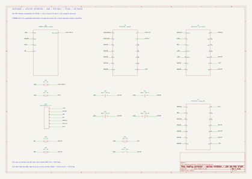

# Prochain banc : inhibition mémorisée, étude TBT

Date : 1er novembre 2026. Schéma F de prototype, non monté ni validé physiquement.
Ce document ne demande aucune modification du câblage ou du firmware installé.
Le [banc quatre paires E](heating_controller_logic_bench.md) reste la référence
testée ; ses sorties sont laissées désactivées. Alimentation USB/3,3 V uniquement.

## Objectif du prochain montage

Retirer l'autorisation des deux registres si l'activité logicielle s'arrête
ou si un défaut est injecté manuellement. La supervision du rail 3,3 V
par le candidat retenu ne garantit pas une inhibition avant sortie de la
plage recommandée du H2 : voir la limite de tension ci-dessous.
Après disparition du défaut, maintenir les sorties inhibées jusqu'à une
nouvelle demande explicite d'armement. Le réseau Thread peut rester absent
sans provoquer de défaut si la boucle locale continue normalement.

Le modèle de la [définition C](heating_controller_v03_logic.md) reste applicable :

```text
Défaut : HEALTH_N = 0 → effacement asynchrone de Q
Armement : nouveau front montant ARM, défaut absent → Q = 1
OE_N = NON(Q ET ARM ET HEALTH_N)
```

Un retour automatique du watchdog au repos ne crée pas de front ARM.
Il ne doit donc pas réautoriser un ancien mot présent dans les registres.
Le signal du superviseur commande la logique d'inhibition ; il n'est pas
prévu de le raccorder au reset du H2 pour ce banc.

## Candidats pour une réalisation sur breadboard

Stock précisé par l'utilisateur : aucun HC74 ni HC10 et aucun autre circuit
logique que les HC595 et LVC244 déjà cités. Des breakouts FT232RL, un Raspberry
Pi Pico W et un RP2040-One sont disponibles. Le prochain montage ne suppose
donc pas la présence des composants candidats ci-dessous. Un adaptateur CMS
à souder est retenu : l'utilisateur confirme pouvoir souder.

| Quantité | Candidat | Rôle | Point pratique |
| --- | --- | --- | --- |
| 1 | SN74HC74N, PDIP-14 | Mémoire d'armement, effacement asynchrone | Traversant ; seconde bascule inutilisée à fixer à des niveaux définis |
| 1 | SN74HC10N, PDIP-14 | NAND trois entrées vers OE_N | Traversant ; entrées inutilisées à fixer, sorties inutilisées libres |
| 1 | SN74HC14N, PDIP-14 | Mise en forme du défaut par deux inverseurs à hystérésis | Traversant ; quatre inverseurs inutilisés à terminer |
| 1 | TPS3828-33DBVR | Watchdog et détection de sous-tension, sortie à drain ouvert | SOT-23-5 sur adaptateur DBV vers pas 2,54 mm |
| 4 | Condensateurs céramique 100 nF supplémentaires | C30 à C33, un par nouveau circuit | Les deux condensateurs existants restent près des 595 |
| 1 | Résistance 4,7 kΩ, 1 % | R30, rappel de HEALTH_RAW_N | Vers 3V3 |
| 3 | Résistances 10 kΩ, 1 % | R31 : MR_N haut ; R33 : ARM bas ; R34 : OE_N haut | Un seul rappel OE_N sur le montage complet |
| 1 | Résistance 1 kΩ, 1 % | R32 : WDI bas | Vers GND, sans résistance série au GPIO |
| 1 | Poussoir NO | SF1 : défaut manuel sur MR_N | Le poussoir existant peut être réutilisé après recâblage |
| 1 | Adaptateur SOT-23-5 DBV vers 2,54 mm et barrettes | Montage de U6 | Vérifier la numérotation réelle des plages de soudure |

Les HC74 et HC10 fonctionnent de 2 à 6 V selon les fiches
[TI HC74](https://www.ti.com/lit/ds/symlink/sn74hc74.pdf) et
[TI HC10](https://www.ti.com/lit/ds/symlink/sn74hc10.pdf).
Ils proposent ici une variante traversante des petites portes LVC de l'étude C.
Les SN74LVC244AN disponibles ne fournissent pas ces fonctions de mémorisation
ou de NAND. Les SN74HC595N du banc LED sont conservés.

La [fiche TI TPS382x](https://www.ti.com/lit/ds/symlink/tps3823.pdf)
distingue le TPS3828 à drain ouvert des variantes à sortie push-pull.
Son watchdog est nominalement de 1,6 s ; la table donne 0,9 à 2,5 s dans
ses conditions de spécification. Ne pas réutiliser la borne 1,36 s du TPS3431.
Le mode désactivé sur WDI flottant exige un rappel externe dimensionné pour
maintenir une valeur définie quand le GPIO est déconnecté ou en haute impédance.
Un rappel ne doit pas être choisi sans tenir compte du courant d'entrée WDI.

Le TPS3431 de l'étude C est en VSON-8, moins commode sur breadboard.
Le TPS3828 est une alternative pour ce prototype, pas un remplacement validé
de toute l'étude C. Un adaptateur SOT-23 est plus accessible, mais demande
encore une soudure ou un module déjà assemblé.

## Documents et interface du schéma F

- [Schéma SVG](heating_controller_inhibit_bench.svg).
- [Source KiCad](heating_controller_inhibit_bench.kicad_sch).
- [Générateur](generate_heating_inhibit.py).



U5 utilise deux inverseurs du [HC14 à hystérésis](https://www.ti.com/lit/ds/symlink/sn74hc14.pdf).
Le signal brut HEALTH_RAW_N passe par U5.1 puis U5.2 et retrouve sa polarité
sur HEALTH_N, avec des fronts logiques pour CLR_N et la NAND. R30 donne le
niveau haut au drain ouvert du TPS3828. Les quatre autres entrées HC14 sont
au GND ; leurs sorties restent libres. Le schéma fixe aussi tous les autres
canaux inutilisés. SF1 agit sur MR_N : ce n'est plus le rappel direct OE_N
au 3V3 du banc E.

| JINH1 | Signal | Raccordement prévu |
| --- | --- | --- |
| 1 | 3V3 | Rail 3V3 de la DevKit, alimentation commune des circuits |
| 2 | GND_TBT | Masse commune |
| 3 | ARM | GPIO10, actif haut ; rappel R33 au GND |
| 4 | WDI | GPIO11, sortie activement pilotée ; rappel R32 au GND |
| 5 | ARMED_Q | Retour de U3.1 Q vers GPIO12, entrée sans rappel interne |
| 6 | HEALTH_N | Retour de défaut remis en forme vers GPIO3, entrée sans rappel interne |
| 7 | OE_N | Broche 13 des deux 595 ; jamais directement au GPIO10 |

Ces sept GPIO, en incluant DATA0/CLOCK1/LATCH22 conservés du banc E, sont
acceptés par un contrôle de schéma local ESPHome 2026.10.1 sur ESP32-H2,
logger USB Serial/JTAG. Il s'agit d'un contrôle de broches uniquement :
aucun firmware ARM/WDI n'est encore écrit, compilé ou installé.

Avant un futur raccordement, retirer l'ancien lien GPIO10/R17 vers OE_N et
l'ancien poussoir S1 entre OE_N et 3V3. Ne garder qu'un rappel OE_N : R34
remplace R18 du banc E, ou réutiliser R18 sans ajouter R34 en parallèle.
Placer ce rappel côté registres ; conserver R18 à cet endroit est possible.
DATA, CLOCK, LATCH, leurs rappels et la cascade des deux 595 sont conservés.
Le firmware du banc E est incompatible avec cette nouvelle interface ARM.

## Budgets et limite de sous-tension

Avec l'hypothèse de courant d'entrée WDI en valeur absolue de 190 µA issue
de la table TI, R32=1 kΩ à 1 % donne au plus 0,192 V sur une entrée non pilotée.
Une résistance de 10 kΩ donnerait 1,919 V sous la même hypothèse et ne garantit
pas l'état bas. À 3,6 V, le courant demandé au GPIO est estimé au plus à
3,83 mA, rappel et courant d'entrée compris. Vérifier le niveau haut réel
sous charge ; ce calcul ne remplace pas les limites du GPIO et du TPS3828.
Les conditions de mesure TI, notamment celles à 5,5 V, ne doivent pas être
présentées comme une mesure sur le prototype 3,3 V.

R30=4,7 kΩ à 1 % limite son courant à environ 0,774 mA à 3,6 V. Le HC14
évite d'appliquer directement une montée lente du drain ouvert au HC74.
Les fronts physiques et les niveaux bas restent à mesurer.

Pour le TPS3828-33, TI donne un seuil descendant nominal de 2,93 V et une
plage de 2,86 à 3,00 V sur −40 à 85 °C. Le H2 recommande au moins 3,0 V
selon sa [fiche Espressif](https://www.espressif.com/sites/default/files/documentation/esp32-h2_datasheet_en.pdf).
Ce composant seul ne garantit donc pas une inhibition avant la limite basse
recommandée du H2. Ce banc permet l'essai de watchdog et de mémorisation ;
la supervision d'alimentation de l'étude C reste à revoir avec un seuil adapté.
L'hystérésis et la temporisation de relâchement ne corrigent pas cette limite.

## Limites et points à qualifier

1. Acheter les composants absents et vérifier les références reçues ; la
    possibilité de souder le SOT-23 sur adaptateur est confirmée.
2. Vérifier les bornes du seuil de la variante -33, l'hystérésis et la marge
    de l'alimentation réelle ; ne pas prendre le seul seuil nominal comme preuve.
3. Mesurer les niveaux WDI et HEALTH_RAW_N, les fronts remis en forme par HC14
    et les délais réels. Ne pas ajouter un gros condensateur directement sur
    une entrée HC pour temporiser l'armement.
4. Vérifier le montage des entrées inutilisées, le découplage et les points
    de mesure définis au schéma, puis le comportement aux montées et chutes du rail.
5. Préparer une configuration ESPHome distincte et la valider avant raccordement.
    ARM, WDI et les retours de diagnostic devront avoir des niveaux définis au reset.

Le GPIO10 du banc actuel commande directement OE_N, actif bas. Le futur ARM
sera actif haut : les deux interfaces ne sont pas interchangeables. Le poussoir
actuel relie OE_N au 3,3 V ; un futur poussoir de défaut vers GND aura un autre
point de raccordement et ne doit pas être déplacé avant schéma validé.

Le signal WDI devra dépendre du calcul et du transfert des commandes, sans
générateur PWM autonome. La proposition de basculement toutes les 100 ms
donne un front descendant toutes les 200 ms ; l'ordonnancement réel et les
marges devront être vérifiés. Après défaut, continuer les diagnostics sans
boucle de réarmement automatique ; vérifier les conditions avant tout front ARM.

## Protocole à prévoir

| Essai | Résultat recherché |
| --- | --- |
| Mise sous tension, sans armement | LED éteintes |
| Défaut absent, commande valide, armement explicite | Affichage du mot demandé |
| WDI figé bas, puis essai séparé figé haut | Inhibition dans les limites du watchdog et de la logique |
| WDI débranché au niveau prévu | Rappel effectif, watchdog non désactivé par entrée flottante |
| Reprise de WDI, ARM laissé haut | Aucune réactivation automatique |
| Défaut manuel puis relâchement | Mémoire de défaut conservée |
| Nouvel armement, défaut réellement absent | Réactivation après contrôles |
| Redémarrage et OTA | ARM bas et sorties inhibées |
| Baisse contrôlée du seul rail TBT | Inhibition puis réarmement explicite après stabilisation |

Ce premier montage ne supervisera pas un rail 5 V de photorelais. Il ne couvre
ni leurs courants, ni les protections secteur, ni toutes les défaillances internes.
Les essais de défaut se feront avec les LED, sans aucun fil pilote raccordé.

Les tests du modèle idéal et des budgets résistifs se lancent avec
`python -B tests/test_heating_design_checks.py`. Ils ne valident pas les fronts,
les seuils analogiques, le câblage ou les délais des composants proposés.

## Contrôles du schéma F

- ERC KiCad : aucune violation.
- Contrôle indépendant des dix nets utiles : bascule, NAND, double inverseur,
  watchdog, rappels, poussoir et entrées inutilisées.
- Vérification visuelle du schéma exporté.
- Dix tests du modèle idéal et des budgets résistifs réussis.
- Aucun montage, flash ni essai physique de l'inhibition mémorisée.

Ces contrôles vérifient la structure décrite et les calculs, sans qualifier
les niveaux, les seuils et les délais électriques du futur montage.

```sh
python -B schematics/generate_heating_inhibit.py
kicad-cli sch erc --exit-code-violations --output /tmp/heating-inhibit-erc.rpt schematics/heating_controller_inhibit_bench.kicad_sch
kicad-cli sch export netlist --output /tmp/heating-inhibit.net schematics/heating_controller_inhibit_bench.kicad_sch
python -B tests/check_heating_inhibit_netlist.py /tmp/heating-inhibit.net
python -B tests/test_heating_design_checks.py
```
