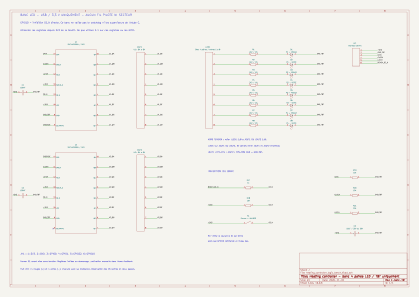

# Banc quatre paires LED — prototype E, USB et 3,3 V

Ce banc permet de vérifier les huit voies logiques avec deux registres
et quatre paires de LED réutilisées en deux passes. Aucun fil pilote,
radiateur, photorelais, module secteur ou alimentation secteur ouverte
ne doit y être raccordé.

Le firmware de banc a été validé, compilé et installé par USB le 1er novembre
2026. Son API chiffrée répond ; les premiers essais physiques sur U1 sont
confirmés ci-dessous, les essais U2 et les contrôles de redémarrage/OTA restent à réaliser.
La V0.2 de simulation reste disponible dans `heating_controller.yaml`.

## Documents et composants

- [Schéma électrique SVG](heating_controller_logic_bench.svg).
- [Projet KiCad](heating_controller_logic_bench.kicad_pro).
- [Point d'entrée ESPHome](../heating_controller_logic_bench.yaml).
- [Générateur du schéma](generate_heating_bench.py).



| Quantité | Composant proposé | Repères |
| --- | --- | --- |
| 1 | ESP32-H2-DevKitM-1 existante, alimentation USB uniquement | Carte de commande |
| 2 | TI SN74HC595N confirmés, boîtier traversant PDIP-16, sous 3,3 V | U1, U2 |
| 4 + 4 | LED d'indication rouges et vertes adaptées à une faible intensité | D1 à D8 |
| 8 | Résistance 2,2 kΩ, 1 %, 0,125 W ou plus | R1 à R8 |
| 1 | Résistance 1 kΩ, 1 %, 0,125 W ou plus | R17 |
| 4 | Résistance 10 kΩ, 1 %, 0,125 W ou plus | R18 à R21 |
| 2 | Condensateur céramique 100 nF, tension nominale ≥6,3 V | C1, C2 |
| 1 | Condensateur électrolytique radial 10 µF, stock 35 V ou 50 V utilisable | C3 |
| 1 | Poussoir à contact normalement ouvert ; maintenir appuyé pour inhiber | S1 |
| Selon montage | Plaque d'essai, fils et supports DIP-16 | Connexions courtes |

JOUT1, JOUT2 et JLED1 représentent des groupes de huit points de raccordement.
Sur breadboard, de simples rangées repérées suffisent ; aucun connecteur spécial
n'est indispensable. R17 à R21 conservent les repères du prototype précédent ;
R9 à R16 et D9 à D16 ne sont plus montés.

C3 est polarisé : borne + au 3V3, borne − au GND. Choisir le 35 V si son
encombrement convient ; le 50 V convient également. Les 100 nF restent
des céramiques non polarisées. Le schéma indique la polarité de C3.

### Stock déclaré et adaptation possible

- Dix-sept LED après complément du stock : 4 rouges 5 mm, 4 vertes 5 mm,
  6 jaunes 5 mm et 3 jaunes 3 mm.
- Toutes les résistances nécessaires, deux céramiques 100 nF, électrolytiques
  10 µF 35/50 V, poussoir, breadboard et fils disponibles.
- Référence des registres reçus confirmée par l'utilisateur : SN74HC595N.
  Deux sont utilisés ; le lot commandé en comporte dix.
- SN74LVC244AN disponibles, mais inutilisables en remplacement des registres.

Les [SN74LVC244A](https://www.ti.com/lit/ds/symlink/sn74lvc244a.pdf) sont
des buffers parallèles, sans registre à décalage ni verrou de mémorisation.
Ils ne remplacent pas les deux 595 du schéma ou du firmware préparé.
Leur utilisation demanderait un autre montage et une autre interface GPIO.

Le montage retenu utilise **quatre paires rouge/verte**, soit huit LED et
huit résistances. Chaque paire P1 à P4 porte une LED rouge « + » et une verte
« − ». Ces signes désignent les alternances simulées ; toutes les anodes
sont alimentées par une sortie via leur résistance et les cathodes vont au GND.
Les neuf autres LED restent en réserve.
Conserver 2,2 kΩ pour commencer ; la luminosité peut varier avec la couleur.
Les références exactes des LED ne sont pas connues et les courants n'ont
pas été mesurés.

Le schéma initial proposait des SN74AHC595N ; le banc est adapté aux
SN74HC595N effectivement reçus, de même brochage et fonction logique.
La [fiche TI SN74HC595](https://www.ti.com/lit/ds/symlink/sn74hc595.pdf)
indique une alimentation de 2 à 6 V. Ici, registres et GPIO partagent le
3,3 V de la DevKit ; les LED restent à faible courant via 2,2 kΩ.
Le transfert GPIO avec des pauses de 1 µs conserve une horloge lente.
Cette substitution concerne le banc LED uniquement ; l'étude matérielle C
conserve ses propres choix de composants. Aucun changement de firmware requis.

Ne pas substituer un 74HCT595 alimenté en 5 V sur la base du seul numéro
595. Les niveaux logiques et l'alimentation de ce schéma sont 3,3 V.

Les LED sont directement alimentées par les sorties via leurs résistances.
Même en supposant une chute LED nulle, 3,6 V et une résistance à −1 %,
le courant reste inférieur à 1,66 mA par sortie, soit 13,3 mA pour huit
sorties. Un seul registre alimente le bloc de huit LED à la fois.
Ces calculs sont des budgets conservateurs de banc ; les valeurs
réelles dépendent des LED et seront relevées à la mise en service.

Le banc utilise des LED d'indication à faible courant : il ne reproduit
pas la charge des LED de photorelais 5 V de l'étude B.

## Organisation des quatre paires et déplacement du bloc

Garder le bloc LED fixe : quatre lignes P1 à P4, verte « − » à gauche,
rouge « + » à droite, selon le montage de l'utilisateur. Chaque LED conserve
sa résistance de 2,2 kΩ. Repérer les huit fils
d'entrée de 1 à 8. Monter les deux registres à cheval sur la rainure
centrale de la breadboard, avec les encoches dans le même sens.
Deux pattes d'une LED ne doivent pas partager un même groupe
de cinq contacts reliés.

Les deux registres restent alimentés et en cascade dans les deux passes.
Relier les huit entrées JLED1 aux points de même numéro de **JOUT1 ou JOUT2**.
Les deux groupes ne sont jamais reliés ensemble : cela court-circuiterait
des sorties pouvant commander des niveaux opposés. La masse reste commune.

| Entrée JLED1 | LED du bloc | Sortie / broche du 595 choisi | Passe U1 / JOUT1 | Passe U2 / JOUT2 |
| --- | --- | --- | --- | --- |
| 1 | P1 rouge + | QA / 15 | FP1 +, séjour 1 | FP5 +, sèche-serviettes |
| 2 | P1 verte − | QB / 1 | FP1 −, séjour 1 | FP5 −, sèche-serviettes |
| 3 | P2 rouge + | QC / 2 | FP2 +, séjour 2 | FP6 +, chambre 1 |
| 4 | P2 verte − | QD / 3 | FP2 −, séjour 2 | FP6 −, chambre 1 |
| 5 | P3 rouge + | QE / 4 | FP3 +, cuisine | FP7 +, chambre 2 |
| 6 | P3 verte − | QF / 5 | FP3 −, cuisine | FP7 −, chambre 2 |
| 7 | P4 rouge + | QG / 6 | FP4 +, couloir / réserve | FP8 +, chambre 3 |
| 8 | P4 verte − | QH / 7 | FP4 −, couloir / réserve | FP8 −, chambre 3 |

Pour changer de passe : désactiver le banc dans Home Assistant,
**débrancher l'USB**, déplacer les huit fils vers l'autre groupe, contrôler
leur ordre puis rebrancher. Le banc redémarre désactivé ; activer ensuite
explicitement le banc avec S1 relâché. Il n'est pas nécessaire de maintenir
le poussoir pendant le câblage hors tension. Un appui sur S1 ne remplace
pas la mise hors tension pendant le déplacement.

## Interface de la DevKit

Le connecteur JH1 est celui du banc. Les repères J1/J3 dans la dernière
colonne désignent les connecteurs de la DevKit, selon le
[guide Espressif](https://docs.espressif.com/projects/esp-dev-kits/en/latest/esp32h2/esp32-h2-devkitm-1/user_guide.html).

| JH1 du banc | Signal | Broche DevKit proposée |
| --- | --- | --- |
| 1 | +3V3 | J1-1, 3V3 |
| 2 | GND_TBT | Une broche GND, par exemple J1-13 |
| 3 | DATA | GPIO0, J1-3 |
| 4 | CLOCK | GPIO1, J1-4 |
| 5 | LATCH | GPIO22, J3-9 |
| 6 | BENCH_OE_N | GPIO10, J3-4 |

Vérifier le repérage de la carte et l'orientation des DIP avant raccordement.
Registres : broche 16 à 3V3, broche 8 à GND, broche 10 à 3V3 ; broches
11 et 12 communes pour CLOCK/LATCH. La broche 9 de U1 va à la broche 14
de U2 ; la broche 9 de U2 reste libre. Les détails du schéma font foi.
Placer chaque 100 nF près de son registre, entre VCC et GND.

R17 sépare GPIO10 du nœud OE_N. R18 tire OE_N à 3V3 au repos. Lorsque
S1 est maintenu appuyé, OE_N est forcé haut et toutes les sorties sont inhibées,
même si GPIO10 demande leur activation ; R17 limite alors le courant.
L'état de S1 n'est pas lu par le firmware. Le poussoir n'est pas verrouillable :
relâcher S1 réautorise immédiatement les sorties si le banc est activé dans HA.

**GPIO10 n'est pas ARM sur ce banc.** Il commande directement OE_N avec
la polarité opposée à l'ARM de l'étude C. Ce câblage et ce firmware ne
doivent donc pas être branchés sur la future carte d'inhibition C.

## Comportement du firmware de banc

Le fichier racine `heating_controller_logic_bench.yaml` réutilise les
packages de la V0.2. Son nom réseau est `heating-controller-bench` et
son nom convivial « Banc LED chauffage ». Il conserve les secrets locaux
API et Thread, sans en créer de nouveaux.

- Les six modes initiaux sont Arrêt, sans restauration.
- Le banc démarre désactivé : le mot `0x5555` est envoyé, mais OE_N reste haut.
- L'interrupteur Home Assistant « Activer le banc LED » autorise ensuite
  les sorties, si S1 est relâché. Il revient désactivé après redémarrage.
- Chaque mot est envoyé bit 15 en premier, avec une seule impulsion LATCH
  après les seize bits ; aucun état intermédiaire n'est présenté aux LED.
- Les enveloppes sont échantillonnées toutes les 50 ms. Les trois appareils
  Séjour cuisine partagent la même phase de cycle.
- « Mot envoyé aux registres » affiche une commande, pas une mesure.
- Le mot conserve seize bits : U1 correspond à l'octet faible (FP1 à FP4),
  U2 à l'octet fort (FP5 à FP8). Le firmware ne sait pas quel groupe de
  sorties est observé. Aucun changement du YAML n'est nécessaire entre les passes.
- Le début de l'OTA désactive le banc ; un échec OTA ne le réactive pas.
- Le shutdown logiciel désactive aussi les sorties. Une panne logicielle
  peut toutefois laisser un ancien mot actif : maintenir S1 inhibe les sorties
  localement, sans mémoriser le défaut. Débrancher l'USB pour une inhibition durable.

Cette variante emploie un transfert GPIO simple et testé plutôt que seize
écritures successives via des sorties individuelles du composant ESPHome :
elle permet de conserver une seule impulsion LATCH par mot. Elle ne
comporte pas encore le watchdog ni les superviseurs matériels de l'étude C.

## Montage et mise en service du banc

1. Garder la carte débranchée pendant le montage. Assembler le schéma
    basse tension avec huit LED, huit résistances et JLED1 relié à JOUT1
    seulement. Vérifier les rails, le sens des circuits et des LED.
2. Vérifier l'absence de court-circuit entre les rails avant de brancher
    l'USB. Pour le premier démarrage, maintenir S1 appuyé pendant la mise
    sous tension ; le banc doit également démarrer désactivé par logiciel.
3. Avec les sorties inhibées, contrôler l'alimentation 3,3 V des registres.
    Ne pas ajouter une alimentation externe simultanée à l'USB de la DevKit.
4. Valider et compiler la configuration, puis identifier le port USB réel :

```sh
esphome config heating_controller_logic_bench.yaml
esphome compile heating_controller_logic_bench.yaml
ls -l /dev/serial/by-id/
```

Après montage et vérifications, remplacer `PORT_USB_REEL` par le port de
la carte et installer ce firmware de banc par USB :

```sh
esphome upload heating_controller_logic_bench.yaml --device PORT_USB_REEL
esphome logs heating_controller_logic_bench.yaml --device PORT_USB_REEL
```

L'identité annoncée change temporairement ; Home Assistant doit joindre
`heating-controller-bench.local` pour cette session de banc. La configuration
V0.2 reste disponible dans `heating_controller.yaml` pour le retour USB.

## Essais à réaliser une fois le montage prêt

Effectuer les essais pour JOUT1 puis, après déplacement hors tension,
pour JOUT2. Les résultats LED ci-dessous portent sur les quatre paires
du groupe actuellement raccordé. Les mots affichés concernent toujours
les seize sorties ; ils ne changent pas avec le raccordement du bloc.

| Essai | Résultat attendu |
| --- | --- |
| Démarrage avec S1 maintenu appuyé | Aucune LED allumée, activation HA désactivée |
| Relâcher S1, activation HA toujours désactivée | Aucune LED allumée |
| Activer le banc, modes initiaux Arrêt | Une LED positive sur chaque paire, mot `0x5555` |
| Tous les modes Confort | Toutes les LED éteintes, mot `0x0000` |
| Tous les modes Éco | Huit LED allumées, mot `0xFFFF` |
| Tous les modes Hors-gel | LED négatives seules, mot `0xAAAA` |
| Changer une zone | Seules ses paires changent ; Séjour cuisine agit sur P1/P2/P3 en passe U1, aucune paire en passe U2 |
| Confort −1 °C, puis −2 °C | Les deux LED de la paire s'allument 3 s ou 7 s par cycle de 300 s, à la résolution du banc |
| Maintenir S1 appuyé pendant un mode actif | Toutes les LED s'éteignent ; la commande HA peut rester activée |
| Désactiver l'activation HA, puis relâcher S1 | Les LED restent éteintes |
| Redémarrer la carte | Modes Arrêt, activation HA désactivée ; aucun rallumage automatique |
| Début d'une mise à jour OTA | Banc désactivé ; réactivation explicite requise |

Ces résultats restent à observer physiquement. La lecture de l'état HA ne
prouve pas le niveau réel des sorties. Le banc ne qualifie pas les charges
fil pilote, les photorelais, les surtensions ou l'isolation secteur.
Les deux passes ne permettent pas d'observer les seize sorties simultanément.

## Vérifications déjà effectuées

- Configuration et compilation : ESPHome 2026.10.1, ESP-IDF 5.5.6, réussite.
- RAM : 38,7 % ; partition applicative : 42,1 %.
- Tests C++ : mapping des huit paires, mots extrêmes, ordre des seize bits
  et impulsion unique de verrouillage, réussite.
- Prototype E : configuration ESPHome validée avec ESPHome 2026.10.1.
- ERC KiCad : zéro erreur et zéro avertissement. Contrôle des quarante nets
  utiles : alimentation, cascade, groupes de sorties séparés, huit résistances/LED
  et inhibition, réussite.
- SVG exporté et inspecté visuellement ; ERC et netlist vérifiés avec les SN74HC595N.
- Installation USB du banc réussie le 1er novembre 2026, intégrité vérifiée.
  API chiffrée confirmée sur `heating-controller-bench`, MAC `48:31:B7:C1:83:0A`.
  Six zones à Arrêt, activation du banc désactivée, mot envoyé `0x5555`.
  Ces états logiciels ne prouvent pas encore les niveaux électriques ou les LED.
- Bloc de quatre paires monté et raccordé à U1 selon l'utilisateur.

### Résultats physiques sur U1 — 1er novembre 2026

L'utilisateur confirme les observations suivantes sur le bloc raccordé à U1,
avec les vertes à gauche et les rouges à droite :

| Essai | Observation confirmée |
| --- | --- |
| Banc désactivé, S1 appuyé puis relâché | Toutes les LED éteintes |
| Activation avec six modes Arrêt, `0x5555` | Quatre rouges allumées, quatre vertes éteintes |
| Six modes Confort, `0x0000` | Huit LED éteintes |
| Six modes Éco, `0xFFFF` | Huit LED allumées |
| Six modes Hors-gel, `0xAAAA` | Quatre vertes allumées, quatre rouges éteintes |
| Séjour cuisine en Confort, autres zones en Hors-gel, `0xAA80` | Seule la verte de P4 allumée |
| Couloir réserve passé en Éco, `0xAAC0` | P4 rouge et verte allumées, P1 à P3 éteintes |
| S1 appuyé puis relâché sur cet état | Extinction de toutes les LED, puis retour de P4 seule |
| Couloir réserve en Confort, Séjour cuisine en Confort −1 °C puis −2 °C | P1 à P3 rouge et verte allumées environ 3 s puis 7 s, P4 éteinte |

Les durées sont des observations approximatives confirmées par l'utilisateur,
pas des mesures instrumentées. La répétition physique à 300 s n'a pas été
observée. Les essais U2, le repli après redémarrage et l'inhibition au début
d'une OTA restent à vérifier physiquement. Aucun étage secteur n'est testé.

Reproduire les contrôles locaux :

```sh
g++ -std=c++17 -Wall -Wextra -Werror tests/heating_bench_test.cpp -o /tmp/heating-bench-test
/tmp/heating-bench-test
python -B schematics/generate_heating_bench.py
kicad-cli sch erc --exit-code-violations --output /tmp/heating-bench-erc.rpt schematics/heating_controller_logic_bench.kicad_sch
kicad-cli sch export netlist --output /tmp/heating-bench.net schematics/heating_controller_logic_bench.kicad_sch
python -B tests/check_heating_bench_netlist.py /tmp/heating-bench.net
```
