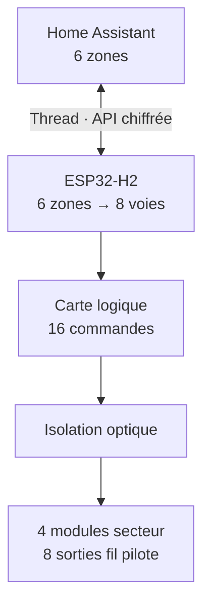
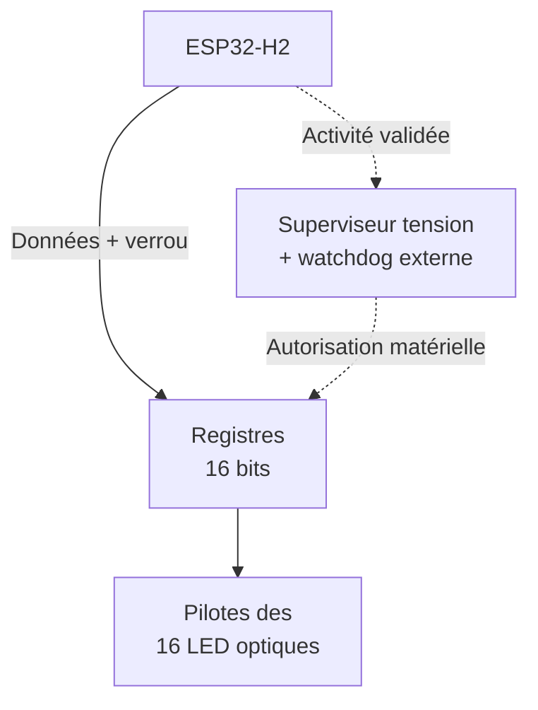
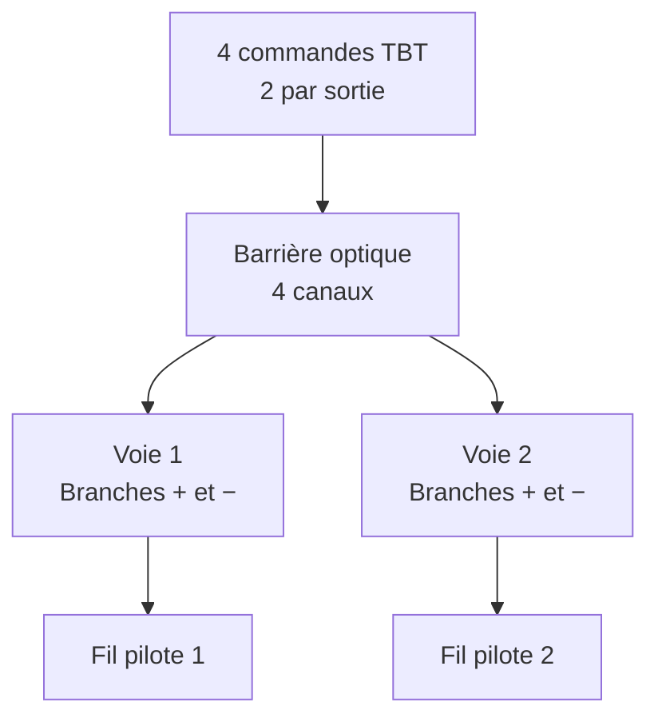

# Architecture du contrôleur de chauffage — V0.3, révision C

Date : 31 octobre 2026. Statut : proposition d'architecture à examiner.
Le prototype installé reste la V0.2 simulée. Ce document ne constitue
pas un schéma de câblage secteur, un PCB validé ou une nomenclature d'achat.

La [note du module deux voies](heating_controller_v03_module.md) et son
[schéma électrique SVG](heating_controller_v03_module.svg) détaillent
maintenant les branches de commande et leur pré-dimensionnement.
La [définition de la carte logique C](heating_controller_v03_logic.md)
précise le mapping, les GPIO proposés et l'inhibition mémorisée.
L'[analyse de protections C](heating_controller_v03_protection.md)
quantifie les inconnues qui empêchent encore de qualifier l'étage secteur.

## Périmètre et décision proposée

Conserver ESP32-H2-DevKitM-1, ESPHome/ESP-IDF, OpenThread FTD et API native
chiffrée. Conserver les six zones Home Assistant et leurs noms actuels.
Prévoir **huit sorties fil pilote indépendantes**, avec deux commandes
logiques par sortie : autorisation d'alternance positive et négative.

Les sorties pilotent les entrées fil pilote ; elles ne commutent pas la
puissance des résistances de chauffage. Les 9 750 W recensés restent
alimentés par les quatre circuits existants.

Huit voies permettent de garder les sept fils pilotes des appareils
actuels séparés, plus la réserve. Le séjour et la cuisine partagent
uniquement leur ordre logiciel. Cette capacité offre également une
évolution possible des zones sans changement du câblage de commande.

## Affectation des voies

| Module proposé | Circuit associé | Voie | Appareil | Zone Home Assistant |
| --- | --- | --- | --- | --- |
| A | C1, 16 A | FP1 | Séjour radiateur 1, 1 500 W | Séjour cuisine |
| A | C1, 16 A | FP2 | Séjour radiateur 2, 1 500 W | Séjour cuisine |
| B | C2, 16 A | FP3 | Cuisine, 1 000 W | Séjour cuisine |
| B | C2, 16 A | FP4 | Couloir, réserve | Couloir réserve |
| C | C3, 16 A | FP5 | Santiago, 750 + 1 000 W | Sèche-serviettes |
| C | C3, 16 A | FP6 | Chambre 1, 1 000 W | Chambre 1 |
| D | C4, 16 A | FP7 | Chambre 2, 1 500 W | Chambre 2 |
| D | C4, 16 A | FP8 | Chambre 3, 1 500 W | Chambre 3 |

C1 à C4 sont des repères documentaires à rapprocher du tableau réel.
Installation annoncée : monophasée, quatre circuits sous le même
interrupteur différentiel. Aucun pontage de phases ou de neutres entre
les départs protégés n'est prévu par cette architecture.

## Schéma fonctionnel

Les flèches de commande ci-dessous représentent des fonctions, pas les
conducteurs d'une installation. Chaque module secteur doit recevoir une
source protégée et un dispositif de sectionnement définis au schéma détaillé.

### Vue 1 — Chaîne de commande

Les huit sorties suivent l'affectation du tableau précédent : A pour le
séjour, B pour cuisine/réserve, C pour SdB/chambre 1, D pour chambres 2/3.
La puissance de chauffage ne traverse pas la carte logique.

### Vue 2 — Carte logique et inhibition

Traits pleins : chemin des commandes. Traits pointillés : surveillance
et autorisation. L'alimentation isolée fournit la carte H2 et les pilotes ;
ses liaisons sont décrites dans la section alimentation pour garder cette
vue centrée sur la commande.

### Vue 3 — Un module secteur, deux sorties

Le module A applique ce principe à FP1/FP2 ; B à FP3/FP4 ; C à FP5/FP6 ;
D à FP7/FP8. Les branches sont côté secteur et leurs commandes côté TBT.
La source secteur protégée et sectionnable de chaque module n'est pas
représentée : elle reste à définir au schéma électrique détaillé.

La frontière TBT/secteur s'applique aussi à l'alimentation et à tout futur
bus de mesure. La masse ESP32 ne devient jamais une référence neutre.

## Carte logique et distribution des commandes

Piste retenue pour l'étude détaillée : deux registres 8 bits à verrou de
sortie et autorisation matérielle commune, candidats SN74AHC595
alimentée en logique 3,3 V, suivis de pilotes de courant adaptés aux LED
des optocoupleurs. Les registres évitent de réserver seize GPIO du H2.

La broche OE du SN74HC595 met les sorties en haute impédance lorsqu'elle
est inactive ; elle ne force pas un niveau bas. Des résistances de rappel
sur les entrées des pilotes doivent garantir l'extinction des LED dans
cet état. Le courant cumulé des LED ne doit pas être fourni directement
par les GPIO ou supposé admissible par les registres.

Les seize bits sont chargés puis appliqués ensemble par le verrou.
L'autorisation reste inactive au démarrage jusqu'à l'initialisation
complète des bits. Un superviseur de tension et un watchdog externe
retirent l'autorisation sur sous-tension ou perte d'activité logicielle.
La définition C ajoute une bascule de mémorisation : le retour au repos
de la sortie temporisée du watchdog ne réautorise pas un ancien mot de
sortie. Un front d'armement explicite est requis après disparition du défaut.
Le signal d'activité doit dépendre du calcul et du transfert correct des
commandes, pas seulement d'un timer autonome. Le watchdog ne détecte pas
toutes les erreurs logicielles ni un composant de sortie en court-circuit.

Les GPIO et les interfaces proposés sont consignés dans la définition C,
sans affectation dans le firmware installé. Les seuils des superviseurs,
le schéma électrique complet de la carte logique et les tests de banc
restent à finaliser avant raccordement matériel.

## Module secteur à deux voies : principe à qualifier

Chaque voie comporte deux branches commutées et sélectionnées en polarité,
pour autoriser séparément les demi-alternances positives et négatives.
L'association des deux restitue les deux alternances. Une isolation
optique sépare les commandes TBT des branches secteur.

| Ordre | Branche positive | Branche négative |
| --- | --- | --- |
| Confort | Inactive | Inactive |
| Éco | Active | Active |
| Hors-gel | Inactive | Active |
| Arrêt | Active | Inactive |
| Confort −1 °C | Deux branches actives 3 s par cycle de 300 s | Identique |
| Confort −2 °C | Deux branches actives 7 s par cycle de 300 s | Identique |

C'est la convention de la simulation actuelle. La polarité réelle dépend
du schéma et devra être vérifiée avant raccordement à un radiateur.
La logique de cycle est commune à une zone : FP1, FP2 et FP3 doivent
partager exactement la même phase temporelle.

L'étude B du module retient comme candidat le photorelais MOSFET
Toshiba TLP240JF, avec une diode par branche. Cette technologie évite
la contrainte de maintien d'un phototriac aux faibles courants. Le courant
réel, les fuites, la charge capacitive, la tenue aux surtensions et
l'isolation de l'ensemble restent à qualifier ; consulter la note liée.
Les familles Vishay VO3053/VO3063 étudiées initialement ne sont pas les
composants représentés dans le schéma électrique B.

Les valeurs des résistances, protections, composants de commutation,
diodes, borniers et distances d'isolement ne sont pas fixées ici. Elles
dépendent notamment du courant d'entrée des radiateurs, des défauts
envisagés, des surtensions et des conditions d'installation.
La note B propose des résistances côté TBT pour étude ; les protections
secteur et les empreintes PCB restent volontairement non définies.

## États de fonctionnement et défauts

| Situation | Comportement demandé | Limite |
| --- | --- | --- |
| Démarrage ou reset | LED inhibées, initialiser les huit voies à Arrêt, puis autoriser | Pendant l'inhibition, absence de signal, donc Confort possible |
| Perte HA ou Border Router | Conserver les modes et cycles tant que le contrôleur fonctionne | Politique validée en V0.2 simulée |
| OTA | Inhiber les commandes avant l'écriture et reprendre Arrêt au démarrage | Confort possible pendant la mise à jour ; stratégie à intégrer au firmware |
| Sous-tension ou watchdog expiré | LED inhibées matériellement | Ne fournit pas un ordre Arrêt |
| Contrôleur non alimenté, radiateurs alimentés | Absence de commande | Confort attendu suivant le réglage local du radiateur |
| Sortie en court-circuit | Ordre réel potentiellement différent de la consigne | Une inhibition LED ne suffit pas ; sectionnement requis |
| Coupure volontaire d'un circuit | Pouvoir isoler également les fils pilotes concernés | À définir avec les protections au schéma d'installation |

**L'architecture proposée n'assure pas un arrêt du chauffage en cas de
panne du contrôleur.** Les thermostats des appareils continuent à réguler
localement. Si un arrêt garanti sur défaut devient une exigence, il faut
revoir l'architecture et définir une fonction de coupure indépendante.
Un ordre fil pilote Arrêt ne réalise pas cette coupure.

## Alimentation, protections et coffret

Prévoir un coffret séparé près du tableau, avec séparation physique des
zones TBT et secteur, borniers protégés et antenne Thread dégagée du métal.
Les passages de câbles et l'accès USB doivent respecter cette séparation.

Pour la version installée, étudier une alimentation AC/DC isolée 5 V
certifiée pour cet usage, de préférence intégrable sur rail DIN. La série
Mean Well HDR-15, variante 5 V, est un candidat à examiner selon le budget
de courant, l'échauffement et les conditions d'intégration. Le module
LM2596S disponible n'assure pas cette isolation secteur/TBT.

Le budget comprendra la carte H2, les LED des seize commandes au pire cas,
les pilotes, le superviseur et une marge. La connexion 5 V et la procédure
de maintenance USB respecteront la révision exacte de la DevKit et ses
options d'alimentation mutuellement exclusives ; aucune double alimentation
USB/externe ne doit être supposée admissible.

Le calibre de protection de la commande et de l'alimentation, la coordination
des protections internes et le sectionnement des fils pilotes sont à définir
avec le schéma d'installation et à faire vérifier. Ne pas confondre le
différentiel commun avec une protection contre tous les courts-circuits.
Le besoin de sectionnement des fils pilotes est rappelé par Schneider [S5].
Les contraintes du tableau plein et du coffret déporté restent à intégrer.

## Réservation pour le comptage V0.4

Préserver le repérage individuel des départs et prévoir l'espace pour les
mesures. Quatre compteurs sur C1 à C4 ne séparent pas les six zones.

Pour six totaux de zones : une mesure séjour regroupant les deux appareils,
une cuisine, une SdB, une chambre 1, une chambre 2, une chambre 3 et une
réserve couloir, soit sept points potentiels. Le total Séjour cuisine
agrège les deux premiers. Cela suppose l'accès aux départs correspondants.
Si les conducteurs de puissance ne sont pas séparables au tableau, une
mesure distribuée ou un autre emplacement sera nécessaire.

Préférer pour la première étude des compteurs/modules de mesure active
documentés, avec interface isolée appropriée. Réserver par exemple un bus
RS-485 isolé si le matériel retenu le permet ; protocole et alimentation
du bus restent à choisir. Un circuit ADE7953 illustre une mesure active
tension/courant [S7], mais n'est pas retenu ici comme compteur huit voies
ni comme solution d'isolation. Ne pas mesurer les fils pilotes pour
estimer la consommation réelle des résistances.

## Livrables suivants et critères de passage

1. Confirmer les plaques signalétiques, l'accès aux départs et les dispositifs
    de protection/sectionnement disponibles avec le tableau et le coffret.
2. Dessiner un module deux voies et la carte logique, avec calculs d'amorçage,
    courant, fuite, dissipation, défauts et isolation ; revue électrique qualifiée
    avant réalisation secteur. Ce document ne remplace pas cette revue.
3. Valider la carte logique sur USB et charges LED, sans secteur : mapping
    6 vers 8, synchronisation, reset, mise à jour, watchdog et sous-tension.
4. Qualifier un seul module secteur sur un banc adapté par une personne
    compétente, avec charge représentative puis radiateur identifié : six
    signaux, polarités, fuites, défauts et récupération. Une basse tension
    d'essai seule ne valide pas le fonctionnement secteur des phototriacs.
5. Reproduire les quatre modules uniquement après qualification du premier,
    puis valider l'intégration dans le coffret et l'installation.

Le firmware de production matérielle devra disposer d'un état réel de
commande distinct de la simple sélection optimiste. Un état de diagnostic
ne doit pas être présenté comme une mesure de tension si aucun retour
matériel isolé ne le mesure.

## Sources primaires consultées

- [S1 — TI SN74HC595, verrou et sorties trois états](https://www.ti.com/product/SN74HC595).
- [S2 — Vishay VO3052/VO3053, phototriac sans passage à zéro](https://www.vishay.com/docs/83749/vo3052.pdf).
- [S3 — Vishay VO3062/VO3063, phototriac avec passage à zéro](https://www.vishay.com/docs/83748/vo3062.pdf).
- [S4 — Mean Well HDR-15, spécifications constructeur](https://www.meanwell.com/Upload/PDF/HDR-15/HDR-15-SPEC.PDF).
- [S5 — Schneider Electric, chauffage et sectionnement fil pilote](https://www.se.com/fr/fr/work/support/local/reglementation/norme-nfc15-100/chauffage/).
- [S6 — Espressif, guide et schémas DevKitM-1 H2](https://docs.espressif.com/projects/esp-dev-kits/en/latest/esp32h2/esp32-h2-devkitm-1/user_guide.html).
- [S7 — Analog Devices, ADE7953](https://www.analog.com/en/products/ade7953.html).

Les tableaux d'installation et notices des radiateurs sont consignés dans
[HEATING_CONTROLLER.md](../HEATING_CONTROLLER.md). Les choix de conception
ci-dessus sont des propositions, distinctes des propriétés documentées
des composants cités.
