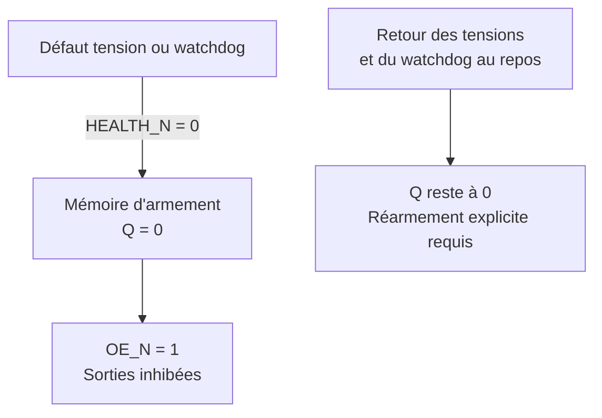

# Carte logique — définition C pour prototype TBT

Cette définition prépare un banc USB sans fils pilotes ni étage secteur.
Les composants ci-dessous sont des candidats documentés ; aucun câblage
physique ni essai de cette carte d'inhibition n'a été réalisé.
Le schéma du module deux voies reste l'étude B.

Un [premier banc D à seize LED](heating_controller_logic_bench.md) est
maintenant préparé avec une configuration ESPHome distincte, validée et
compilée, sans installation sur carte. Il vérifie les registres et les
cycles avec une inhibition directe, avant ajout de la mémoire de défaut
et des superviseurs définis ici. Son interface GPIO10 est différente.

## Registres et interface des huit voies

Préciser le candidat initial : utiliser deux **SN74AHC595** sous 3,3 V.
Ne pas assimiler sans vérification les garanties de sortie de la famille
AHC à celles d'un HC595 quelconque. La [notice TI](https://www.ti.com/lit/ds/symlink/sn74ahc595.pdf)
spécifie notamment VOH ≥ 2,48 V à 3 V, −4 mA, de −40 à 85 °C.
Cela couvre le courant individuel de base envisagé, sous réserve de
maintenir les alimentations, les budgets cumulés et les températures.

| Broche des registres, boîtier 16 broches | Connexion proposée |
| --- | --- |
| 16 VCC / 8 GND | 3V3 / GND_TBT ; 100 nF de découplage par circuit |
| 14 SER du premier | DATA du H2 |
| 9 QH' du premier | 14 SER du deuxième |
| 11 SRCLK des deux | CLOCK commun |
| 12 RCLK des deux | LATCH commun |
| 10 SRCLR_N des deux | Niveau haut défini ; ce signal n'efface pas le verrou de sortie |
| 13 OE_N des deux | Inhibition matérielle, rappel haut proposé 10 kΩ |
| 15, 1, 2, 3, 4, 5, 6, 7 | QA à QH, huit commandes par circuit |
| 9 QH' du deuxième | Non connecté intentionnellement |

Les registres fournissent les commandes, pas le courant des LED des
photorelais. Les quatre pilotes NPN de chaque module restent utilisés.
Prévoir des niveaux définis pour DATA/CLOCK/LATCH pendant le reset ;
valeurs de rappel proposées 10 kΩ. Leurs charges s'ajoutent au budget GPIO.
Les fronts et la distribution de CLOCK/LATCH devront être vérifiés au banc.

| Mot de sortie, bit 0 en premier registre QA | Destination |
| --- | --- |
| 0 / 1 | FP1 séjour 1, positive / négative |
| 2 / 3 | FP2 séjour 2, positive / négative |
| 4 / 5 | FP3 cuisine, positive / négative |
| 6 / 7 | FP4 réserve couloir, positive / négative |
| 8 / 9 | FP5 SdB, positive / négative |
| 10 / 11 | FP6 chambre 1, positive / négative |
| 12 / 13 | FP7 chambre 2, positive / négative |
| 14 / 15 | FP8 chambre 3, positive / négative |

Transmettre 16 bits du bit 15 au bit 0, puis une seule impulsion LATCH.
Le premier registre reçoit ainsi les bits 0 à 7, le second les bits 8 à 15.
Les bits des trois appareils Séjour cuisine proviennent d'une même phase
de cycle logicielle, sans trois temporisations indépendantes.

Mot initial Arrêt : `0x5555`. Confort sur toutes les voies : `0x0000`.
Éco sur toutes les voies : `0xFFFF`. Ces mots n'ont d'effet que si OE_N=0.

## Proposition de GPIO, sans modification de la configuration installée

| Signal | GPIO proposé | Repère DevKitM-1 documenté |
| --- | --- | --- |
| DATA | GPIO0 | J1, broche 3 |
| CLOCK | GPIO1 | J1, broche 4 |
| LATCH | GPIO22 | J3, broche 9 |
| ARM | GPIO10 | J3, broche 4 |
| WDI | GPIO11 | J3, broche 5 |
| Retour Q d'autorisation | GPIO12 | J3, broche 7 |

Ces positions proviennent du [guide Espressif](https://docs.espressif.com/projects/esp-dev-kits/en/latest/esp32h2/esp32-h2-devkitm-1/user_guide.html).
Elles évitent ici USB, UART, LED intégrée et les GPIO13/14 pouvant servir
au quartz 32 kHz. Vérifier le repérage sur la révision physique avant
câblage ; les numéros J1/J3 sont ceux de la carte, pas ceux du module fil pilote.
Le prochain firmware de banc devra faire valider ces GPIO par ESPHome
avant tout raccordement ; aucune section GPIO n'a été ajoutée à la V0.2.

## Inhibition avec mémoire du défaut

Un raccordement direct du watchdog à OE ne suffit pas pour obtenir une
inhibition mémorisée. Le [TPS3431](https://www.ti.com/lit/ds/symlink/tps3431.pdf)
produit une assertion WDO temporisée. Après retour de WDO au repos, les
registres pourraient reprendre un ancien mot si aucune mémoire ne bloque OE.

Proposition à dessiner et qualifier :

| Composant candidat | Fonction et connexions logiques |
| --- | --- |
| TPS3431 | EN et SET1 fixés actifs ; CWD non connecté : délai nominal 1,6 s ; WDI issu du H2 |
| Superviseur rail 3V3 | Sortie RESET_N à drain ouvert, seuil à vérifier avec la logique et le H2 |
| Superviseur rail 5V_LED | Sortie RESET_N à drain ouvert, seuil à calculer avec le courant LED minimal |
| SN74LVC1G74 | D=1, PRE_N=1, CLK=ARM, CLR_N=HEALTH_N ; Q mémorise l'armement |
| SN74LVC1G10 | OE_N = NON(Q ET ARM ET HEALTH_N) |

HEALTH_N est le signal commun à drain ouvert des deux superviseurs et de
WDO, avec rappel vers 3V3. Tout défaut le force bas. Les niveaux de sortie,
les courants de rappel et l'absence de rétro-alimentation doivent être
vérifiés ; ne pas relier à ce nœud une sortie push-pull.

La [bascule TI](https://www.ti.com/lit/ds/symlink/sn74lvc1g74.pdf)
se remet à zéro par CLR_N indépendamment de l'horloge. Une fois le défaut
disparu, Q reste bas tant qu'un nouveau front montant ARM ne survient pas.
La [porte NAND trois entrées](https://www.ti.com/lit/ds/symlink/sn74lvc1g10.pdf)
inhibe aussi immédiatement sur ARM=0 ou HEALTH_N=0.



ARM reçoit un rappel bas matériel. Le logiciel maintient ARM bas pendant
le démarrage et l'OTA. Après stabilisation des deux rails, il charge le
mot initial, vérifie les défauts, commence les signaux d'activité, puis
produit le front d'armement. Le délai entre libération CLR_N et front ARM
doit respecter les caractéristiques recovery/removal de la bascule.
L'armement ne constitue pas une preuve de lecture du mot des registres.

Le logiciel ne doit pas réarmer automatiquement en boucle après défaut.
Il doit signaler le défaut et requérir une procédure explicite. Le réseau
peut tomber sans inhiber les voies si la boucle locale reste saine.

Pour le watchdog, proposer un basculement WDI toutes les 100 ms, uniquement
après traitement des modes et transmission des sorties : fronts descendants
toutes les 200 ms. Le minimum publié du timeout avec CWD ouvert est 1,36 s.
Le temps maximal de réaction, les blocages OTA, les perturbations et les
horloges devront être mesurés sur le prototype ; le modèle ne les valide pas.

## Supervision des alimentations : seuils encore ouverts

La famille [TPS3808](https://www.ti.com/lit/ds/symlink/tps3808.pdf)
offre des sorties à drain ouvert et des seuils fixes/ajustables, mais sa
précision typique ne doit pas servir de borne garantie. L'ajustable G01
est notamment donné à ±2 % dans la table de limites ; inclure aussi
tolérances du pont, courant SENSE, hystérésis et temporisation de relâchement.

Avec RLED=560 Ω, Vf≤1,50 V et VCE≤0,25 V supposés, le courant minimal
de 5 mA impose `V5 ≥ 0,005 × 565,6 + 1,50 + 0,25 = 4,578 V`.
Le seuil bas réel doit inhiber avant de descendre sous cette tension.
Le seuil haut réel, hystérésis comprise, doit permettre le réarmement
avec le minimum garanti de l'alimentation, actuellement supposé à 4,75 V.
Cette fenêtre étroite exige une vérification des tolérances ; aucun pont
résistif ni superviseur 5 V n'est donc déclaré validé dans cette étude.

Si la fenêtre n'est pas réalisable avec le candidat choisi, revoir le
courant LED, l'alimentation ou la précision du superviseur, puis recalculer
la commande NPN. Il faut également tester 5 V présent / 3V3 absent et
l'inverse, pour exclure des courants parasites dans les commandes.

## Validation du futur prototype USB

1. Remplacer les charges optiques par des charges LED basse tension adaptées,
    sur une carte sans aucun conducteur secteur ; relever les courants.
2. Vérifier les seize commandes, le mot initial, l'ordre série et la mise
    à jour simultanée, puis les cycles 3/7 s sur FP1/FP2/FP3 synchronisés.
3. Vérifier que reset et OTA inhibent les sorties avant changement du mot.
4. Arrêter les fronts WDI : constater l'inhibition et son maintien après
    relâchement du défaut, malgré un ancien ARM resté haut.
5. Tester chaque sous-tension et le réarmement explicite. Mesurer les seuils,
    l'hystérésis et les délais ; ne pas transférer une conclusion du modèle
    numérique au circuit analogique sans ces mesures.

Un modèle idéal et huit tests reproductibles accompagnent cette définition :

```sh
python -B tests/test_heating_design_checks.py
python -B schematics/heating_design_checks.py
```

Ils vérifient la mémoire du défaut, la priorité de l'inhibition, le mapping
6 vers 8 et les calculs. Ils ne simulent pas les composants, les parasites,
les alimentations, les broches au reset ni les signaux réels.
