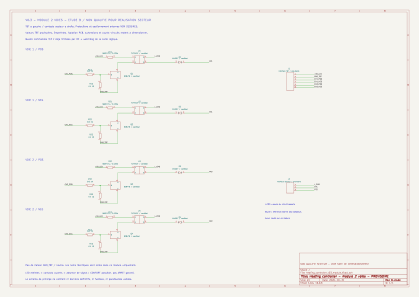

# Module fil pilote deux voies — étude B

Statut : **schéma de principe non qualifié pour réalisation secteur**.
La carte installée reste en V0.2 simulée, sans nouvelle affectation GPIO.

## Documents à examiner

- [Vue électrique SVG](heating_controller_v03_module.svg), zoomable.
- [Schéma KiCad éditable](heating_controller_v03_module.kicad_sch).
- [Projet KiCad](heating_controller_v03_module.kicad_pro) et bibliothèque
  locale `Heating.kicad_sym`, déclarée dans `sym-lib-table`.
- [Générateur reproductible](generate_heating_module.py), symboles inclus.



Le schéma contient quatre branches : positive/négative de FP1, puis
positive/négative de FP2. Les rectangles U sont des photorelais ; les
rectangles Q représentent des transistors NPN avec broches B/E/C nommées.
Ce sont des symboles de principe ; aucune empreinte PCB n'est attribuée.

## Choix de commutation

Étudier le **Toshiba TLP240JF**, photorelais à sortie MOSFET normalement
ouverte, pour éviter la contrainte de maintien des commutateurs à triac.
La variante JF offre une géométrie d'isolation plus large que J.

Données de la [notice constructeur, révision consultée 12.0.A](https://toshiba.semicon-storage.com/info/docget.jsp?did=13997&prodName=TLP240JF)
et de la [fiche produit](https://toshiba.semicon-storage.com/us/semiconductor/product/isolators-solid-state-relays/photorelay-mosfet-output/detail.TLP240JF.html) :

| Paramètre | Valeur publiée, avec conditions à respecter |
| --- | --- |
| Tension de blocage maximale | 600 V |
| Courant de sortie maximal | 90 mA à 25 °C, à déclasser en température |
| Courant LED recommandé | 5 mA minimum ; 7,5 mA typique |
| Résistance fermée maximale, régime continu | 60 Ω à 25 °C, LED 5 mA |
| Fuite de sortie maximale | 1 µA à 600 V, 25 °C |
| Capacité de sortie | 75 pF typique, pas un maximum garanti |
| Temps de fermeture / ouverture maximaux | 2 ms / 1 ms dans le circuit d'essai indiqué |
| Test d'isolation entrée/sortie | 5 kV RMS pendant 60 s |
| Distances du boîtier JF | 8 mm minimum d'isolement et de fuite |

Ces caractéristiques ne constituent pas une qualification de l'appareil
complet. La tenue permanente, les surtensions et les distances sur le PCB
doivent être examinées séparément. Le brochage 1=A, 2=K, 3/4=sortie est
repris dans le symbole embarqué ; l'empreinte JF reste à vérifier.

À titre de comparaison, le TLP240A est une autre référence, limitée à
60 V : ne pas le substituer au TLP240JF.

## Circuit de principe

Pour chaque branche, une LED de photorelais reçoit le 5 V via Rn1 et
un NPN Qn assure le retour vers GND_TBT. Rn2 limite le courant de base,
Rn3 maintient le transistor éteint lorsque l'entrée est flottante.
La commande doit provenir des registres dont l'autorisation matérielle
est retirée au démarrage, en sous-tension et sur défaut watchdog.
Cette inhibition est externe au module, donc absente de cette feuille.

Côté secteur, chaque photorelais est en série avec une diode de sélection
de polarité. D1/D3 autorisent le courant conventionnel de L_CMD vers FP,
D2/D4 le sens inverse. Les sorties FP1 et FP2 ne sont pas reliées entre elles.
Le neutre est la référence externe de l'entrée fil pilote du radiateur ;
il ne se raccorde pas à GND_TBT et n'entre pas dans ce module de principe.

La famille [1N4007 Vishay](https://www.vishay.com/docs/88503/1n4001.pdf)
constitue le candidat de diode 1 000 V. Cette caractéristique seule ne
valide pas sa coordination avec le photorelais, les défauts et les protections.

## Pré-dimensionnement TBT, valeurs à qualifier

Hypothèses de calcul proposées, à vérifier sur composants et alimentation :
5 V ±5 %, enveloppe LED 0 à 1,5 V, VCE saturé au plus 0,25 V,
résistances ±1 %. La borne LED 0 V sert au budget maximal conservateur ;
la borne 1,5 V est une hypothèse de conception à vérifier sur la plage
thermique, pas une garantie constructeur à toutes températures.

| Élément par branche | Proposition | Rôle |
| --- | --- | --- |
| U1 à U4 | TLP240JF | Isolation et contact MOSFET |
| Q1 à Q4 | BC847B, fabricant à figer | Pilote de LED ; vérifier saturation et brochage |
| R11/R21/R31/R41 | 560 Ω, 1 %, 0,125 W minimum | Courant LED |
| R12/R22/R32/R42 | 2,2 kΩ, 1 % | Courant de base |
| R13/R23/R33/R43 | 47 kΩ, 1 % | Rappel base-émetteur |
| D1 à D4 | 1N4007, fabricant et boîtier à figer | Sélection des polarités |

Calculs pour Rn1 = 560 Ω :

```text
IF_min = (4,75 − 1,50 − 0,25) / (560 × 1,01) = 5,30 mA
IF_max conservateur = 5,25 / (560 × 0,99) = 9,47 mA
PR_max conservateur = 5,25² / (560 × 0,99) = 49,7 mW
Budget LED, module 2 voies : 4 × 9,47 = 37,9 mA
Budget LED, contrôleur 8 voies : 16 × 9,47 = 151,5 mA
```

Ces budgets ne comprennent ni la carte H2 ni la logique. Pour les entrées,
un exemple défavorable VOH=2,4 V et VBE=1,2 V donne environ 0,515 mA de
base après courant dans 47 kΩ. Un gain forcé de 20 permettrait alors
10,3 mA. Il faut confirmer les garanties VOH de la référence exacte des
registres, VBE/VCE du NPN choisi, la température et le courant cumulé.
Le budget maximal conservateur des seize entrées est d'environ 24,3 mA
pour 3,3 V, VBE supposé nul et Rn2 à sa tolérance basse.

Ces valeurs sont un pré-dimensionnement, pas des preuves de conformité.
Les limites du photorelais, de la LED et du transistor doivent rester
respectées ensemble sur la plage de température du coffret.

## Charge, chute de tension et fuite

Le courant réel des entrées fil pilote n'a pas été fourni par les notices
consultées. Une hypothèse d'étude à **5 mA RMS par sortie** donne une
majoration simple de chute résistive de 0,30 V et de dissipation de
1,5 mW pour 60 Ω. Ce n'est ni un courant mesuré ni un maximum garanti
des radiateurs. La forme du courant et ses pointes restent à vérifier.

Une entrée capacitive ou redressée peut avoir un courant de crête élevé.
Il faut qualifier l'amorçage, le fonctionnement des six ordres, la tension
de sortie et le courant de chaque branche sur une charge représentative.

À 253 V RMS, la crête sinusoïdale vaut environ 358 V : elle est inférieure
aux 600 V du composant, mais ce calcul ne couvre aucune surtension.
Une protection choisie uniquement par sa tension nominale pourrait laisser
passer une crête supérieure à la tenue du photorelais.

L'ordre Confort exige l'absence de signal reconnu par le radiateur.
Le courant de fuite continu ne suffit pas à caractériser cet état :
75 pF sous 253 V, 50 Hz correspond à environ 6 µA capacitifs, à titre
indicatif. Les deux branches et les autres capacités du montage doivent
être considérées. Ni un multimètre seul, ni la fuite de fiche technique
ne démontrent la reconnaissance de Confort sur les appareils réels.

## Protections et isolation : points non résolus

L'[analyse C des protections](heating_controller_v03_protection.md)
complète cette liste par des calculs de courant de défaut, chute de tension
et dissipation. La [définition logique C](heating_controller_v03_logic.md)
précise les registres AHC595, le mapping et la mémoire d'inhibition.

Le schéma ne contient pas encore les éléments suivants ; il ne doit donc
pas être utilisé pour réaliser ou brancher un module secteur :

- Protection du module et limitation de l'énergie de défaut : les 16 A
  des circuits ne protègent pas directement un photorelais de 90 mA.
- Protection contre les surtensions, avec tension de limitation et énergie
  réellement compatibles ; un éventuel réseau RC doit aussi être évalué
  pour le courant qu'il injecterait dans le fil pilote au repos.
- Sectionnement des fils pilotes et coordination avec chaque circuit.
- Borniers, enveloppe, cheminements, tenue au feu et isolation du PCB,
  selon les conditions d'installation. Les 8 mm du boîtier ne déterminent
  pas à eux seuls les distances de toutes les pistes et des connecteurs.
- Courants réels des entrées et comportement en cas de diode ou de
  photorelais ouvert/court-circuit. Un court-circuit de diode peut transformer
  une commande demi-alternance en commande pleine alternance.

Éteindre toutes les LED ou perdre l'alimentation du contrôleur ouvre les
contacts : **Confort reste possible, pas un arrêt garanti du chauffage**.

## Vérifications réalisées et reproduction

KiCad 10.0.6 charge le projet ; ERC : **zéro erreur, zéro avertissement**.
Le contrôle ERC vérifie la cohérence du dessin, pas le dimensionnement,
les protections ou l'isolation physique. La netlist est également contrôlée
pour les polarités de diodes, les quatre chaînes de commande, les sorties
distinctes et l'absence de connexion conductrice TBT/secteur.

```sh
python schematics/generate_heating_module.py
kicad-cli sch erc --exit-code-violations --output /tmp/heating-v03-erc.rpt schematics/heating_controller_v03_module.kicad_sch
kicad-cli sch export netlist --output /tmp/heating-v03-module.net schematics/heating_controller_v03_module.kicad_sch
python tests/check_heating_module_netlist.py /tmp/heating-v03-module.net
kicad-cli sch export svg --output schematics/ schematics/heating_controller_v03_module.kicad_sch
python -B schematics/normalize_svg.py schematics/heating_controller_v03_module.svg
```

Rendu exporté et inspecté visuellement. Aucun PCB, achat, raccordement
secteur ou modification du firmware n'a été effectué. Étape suivante :
lever les inconnues de courant et dimensionner les protections avec une
revue qualifiée, puis préparer le prototype TBT de la carte logique.
